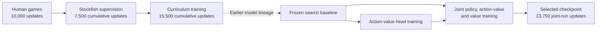

# NeuroChess

NeuroChess is a chess engine built around a 155.7 million parameter Transformer and PUCT tree search. The network evaluates positions and legal moves. A C++ and CUDA runtime runs the search and TensorRT inference through the Universal Chess Interface (UCI).

[Download the model](https://github.com/ddy314/NeuroChess/releases/tag/model-v1) · [Training history](docs/TRAINING.md) · [Evaluation](docs/EVALUATION.md) · [Model and runtime](docs/MODEL.md)

## At a glance

| | |
|---|---|
| Network | 16 Transformer layers, 896 channels, 14 attention heads |
| Outputs | Move policy, action values, and win/draw/loss probabilities |
| Model | Joint training checkpoint at step 13,750; 56.32 million sample presentations in that run |
| Search | Batched PUCT with a neural evaluation cache |
| Runtime | PyTorch for network inspection; C++17, CUDA and TensorRT for UCI play |
| Model file | 622,819,723 bytes |

The model was selected using held-out policy, action-value and value losses. Its search playing quality awaits the direct promotion test against the project's locked two-second baseline. The [evaluation guide](docs/EVALUATION.md) describes the match results and their scope.

## Training

The project trained the network in several stages. The final joint run starts from a frozen earlier network and a separately trained action-value head. Step numbers belong to their respective runs.



The final run sampled earlier Stockfish-labelled and replay data, ChessBench, and six- and seven-piece Syzygy positions. It also used Stockfish corrections. The planned sampling mix was 45%, 15%, 25%, 12%, and 3%, respectively. The selected checkpoint saw 56.32 million presentations; a position can appear more than once. [Training history](docs/TRAINING.md) covers the data, training stages, selection and available records.

## Results

The following experiment used the released checkpoint, INT8 TensorRT inference and Stockfish 18 with one thread. Each opening was played with both colours. The equivalent-node estimate depends on the opening set and the fitted model.

| Search simulations per move | Estimated Stockfish nodes per move | 90% paired resampling interval | Games |
|---:|---:|---:|---:|
| 8,192 | 7,981 | 5,782–10,361 | 128 |

On an RTX 4060 Laptop GPU, a 12-position comparison at 8,192 simulations measured median move times of 1.65 seconds for the native runtime and 1.90 seconds for the Python runtime using TensorRT. The two runs selected the same move on 11 positions. See [evaluation](docs/EVALUATION.md) for the protocol, evidence and search baseline.

## Get started

Python 3.11 or later is required. Install a PyTorch build suitable for your system. Download the model from the [model release](https://github.com/ddy314/NeuroChess/releases/tag/model-v1).

```bash
git clone https://github.com/ddy314/NeuroChess.git
cd NeuroChess
python -m venv .venv
source .venv/bin/activate
pip install -e '.[dev]'
mkdir -p models
curl -L -o models/neurochess-13750.pt https://github.com/ddy314/NeuroChess/releases/download/model-v1/neurochess-13750.pt
echo '910e517774770754500ff3ad6b66380d0bf3d36f5e1f85f7b2451407b95c18a7  models/neurochess-13750.pt' | sha256sum -c -
python -m neurochess.predict --model models/neurochess-13750.pt
```

The last command evaluates the starting position with the network. Use `--fen '<FEN>'` to inspect another position and `--device cpu` to select the CPU.

### Build the UCI engine

The engine requires an NVIDIA GPU, a compatible CUDA Toolkit, CMake 3.24 or later, a C++17 compiler, and TensorRT headers, libraries and Python bindings. Install the TensorRT Python package that matches the local SDK. Export the model on the target machine:

```bash
pip install -e '.[export]'
python -m neurochess.export --model models/neurochess-13750.pt --out models/
cmake -S engine -B engine/build -DTENSORRT_ROOT=/path/to/TensorRT
cmake --build engine/build -j
./engine/build/neurochess --engine models/neurochess-13750-int8.plan \
  --uci --history-free --batch 16 --q-prior-beta 2 --cache 32768 \
  --time -1 --simulations 8192
```

Add the executable and arguments to a UCI-compatible chess interface. TensorRT plans depend on the target environment. Export details and hardware requirements are in [model and runtime](docs/MODEL.md).

## Repository

| Path | Contents |
|---|---|
| [`neurochess/`](neurochess/) | Model, board encoding, prediction and TensorRT export |
| [`engine/`](engine/) | Native UCI engine, search and inference runtime |
| [`docs/`](docs/) | Training, evaluation and model documentation |
| [`tests/`](tests/) | Model and optional UCI integration tests |

Run `pytest -q` for the available tests. Set `NEUROCHESS_PLAN` to a built TensorRT plan to enable UCI integration tests. The current repository contains inference and search code; historical training code is available in [the pre-cleanup revision](https://github.com/ddy314/NeuroChess/tree/6681cc3).

Move generation uses [Disservin/chess-library](https://github.com/Disservin/chess-library), included under its MIT license.
