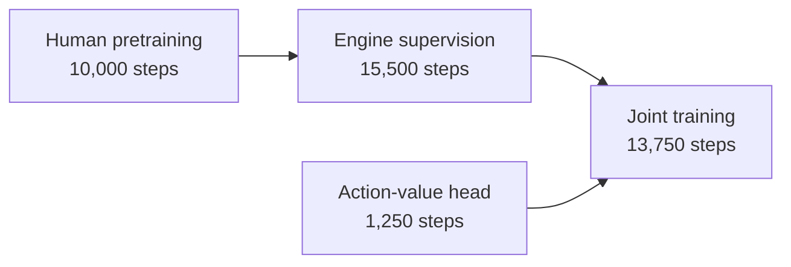

# Training

NeuroChess was trained in four stages across human games, Stockfish analysis, ChessBench positions, and Syzygy endgame tablebases.

## Training stages

1. **Human-game pretraining (10,000 steps):** Trained on positions and moves from filtered [Lichess](https://database.lichess.org/) rated and broadcast games to learn piece coordination and opening/middlegame priors.
2. **Engine supervision (15,500 steps):** Trained on Stockfish policy, action-value, and WDL targets across up to 5M positions, combining engine-labeled positions, deeper Stockfish reannotations of difficult positions, and human-policy replay.
3. **Action-value head training (1,250 steps):** Trained the 128-bin cross-attention `Q` head on Stockfish move evaluations and Syzygy endgames.
4. **Joint multi-task training (13,750 steps):** Trained the Transformer backbone and all three output heads end-to-end across Stockfish analysis, game replay, ChessBench, and Syzygy endgames at an effective batch size of 4,096 (`56.32M` training samples).

## Training data and optimization

The joint training stage sampled batches from five sources:

| Source | Share | Role |
|---|---:|---|
| Deep Stockfish analysis | 45% | Policy, action-value, and WDL supervision |
| Game replay positions | 15% | Retention across human and self-play trajectories |
| ChessBench | 25% | Large-scale position diversity and evaluation targets |
| [Syzygy](https://syzygy-tables.info/) 7-piece endgames | 12% | Exact WDL outcomes and optimal-outcome move targets |
| [Syzygy](https://syzygy-tables.info/) 6-piece endgames | 3% | Exact WDL outcomes and optimal-outcome move targets |

Joint training ran in FP16 on an NVIDIA L4 with microbatch size 256 and effective batch size 4,096, weighting policy, action-value, and WDL losses at `1.0`, `0.5`, and `1.0`. Hidden Transformer matrices used the Muon optimizer, while embeddings, output layers, LayerNorm gains, and biases used Adam.

## Validation metrics

Evaluated on held-out validation splits at the end of joint training:

| Held-out split | Policy top-1 | Value MAE | Action-value MAE |
|---|---:|---:|---:|
| Engine-labeled positions | 42.6% | 0.140 | 0.136 |
| Replay positions | 46.4% | 0.142 | 0.133 |
| 7-piece Syzygy endgames | 94.9% | 0.114 | 0.157 |
| 6-piece Syzygy endgames | 95.4% | 0.064 | 0.106 |

The released weights are available on the [release page](https://github.com/ddy314/NeuroChess/releases/tag/model-v1).
