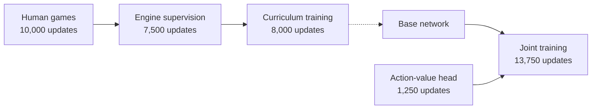

# Training

NeuroChess was trained in stages from human games to engine supervision, targeted curriculum refinement, and finally joint multi-task training with endgame tablebases.

## Training pipeline

1. **Human-game pretraining (10,000 updates):** Trained on positions and moves from filtered [Lichess](https://database.lichess.org/) rated and broadcast games to bootstrap piece coordination and opening/middlegame priors.
2. **Engine supervision (7,500 updates):** Switched to Stockfish-labeled policy, action-value, and WDL targets while scaling the dataset from 842k to 5M positions.
3. **Hard-position curriculum (+8,000 updates):** Ran 4,000 updates mixing engine data with human-policy replay, followed by four 1,000-update waves sampling core engine positions, deeper Stockfish reannotations of difficult positions, and human-policy replay (`70:20:10`). On the fixed 8,457-position validation set, loss fell from `2.5629` (step 1,500) to `2.4178` (step 15,500) and policy top-1 accuracy rose from `42.19%` to `44.19%`.
4. **Action-value head training (1,250 updates):** Trained the redesigned 128-bin cross-attention `Q` head separately on engine evaluations and Syzygy endgames.
5. **Joint multi-source training (13,750 updates):** Combined the trained base network and 128-bin `Q` head and trained the full model end-to-end across five data sources plus targeted Stockfish corrections.

## Joint training data and optimization

The final joint run mixed five datasets per batch:

| Source | Share | Purpose |
|---|---:|---|
| Deep Stockfish analysis | 45% | Broad positional and tactical policy, `Q`, and WDL supervision |
| Game replay positions | 15% | Retention on human and self-play trajectories |
| ChessBench | 25% | Large-scale position diversity and evaluation targets |
| [Syzygy](https://syzygy-tables.info/) 7-piece endgames | 12% | Exact WDL outcomes and optimal-outcome move targets |
| [Syzygy](https://syzygy-tables.info/) 6-piece endgames | 3% | Exact WDL outcomes and optimal-outcome move targets |

Training ran in FP16 on an NVIDIA L4 with an effective batch size of 4,096 (microbatch size 256), weighting policy, action-value, and WDL losses at `1.0`, `0.5`, and `1.0`. Hidden Transformer matrices used the Muon optimizer, while embeddings, output layers, LayerNorm gains, and biases used Adam.

## Validation gains

Comparing the released checkpoint (`neurochess-13750.pt`, step 13,750, 56.32M training samples) against its joint-training starting point shows substantial improvements in value calibration and endgame accuracy across held-out sets:

| Validation set | Policy top-1 (before → after) | Value MAE (before → after) | Action-value MAE (before → after) |
|---|---:|---:|---:|
| Engine-labeled positions | 38.7% → 42.6% | 0.238 → 0.140 | 0.218 → 0.136 |
| Replay positions | 43.6% → 46.4% | 0.222 → 0.142 | 0.205 → 0.133 |
| 7-piece Syzygy | 91.3% → 94.9% | 0.324 → 0.114 | 0.343 → 0.157 |
| 6-piece Syzygy | 94.8% → 95.4% | 0.249 → 0.064 | 0.266 → 0.106 |

Pretrained weights are hosted on the [release page](https://github.com/ddy314/NeuroChess/releases/tag/model-v1), and historical training scripts are preserved at [revision `6681cc3`](https://github.com/ddy314/NeuroChess/tree/6681cc3).
