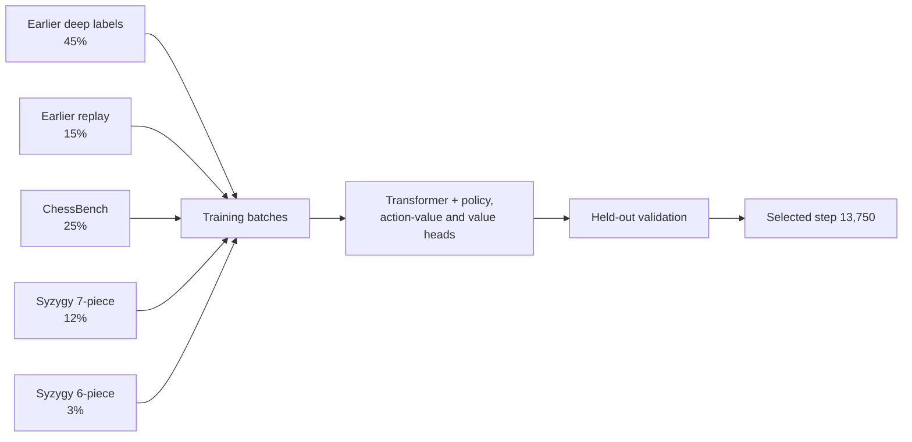

# Training history

The released model combines a trained board encoder, policy and value heads with a redesigned action-value head. The project then trained all components together. This page records the main stages and the sources available for each stage. The step counters below belong to different runs.

## Main stages

| Stage | Training and data | Recorded outcome |
|---|---|---|
| Human-game pretraining | Positions and moves from filtered human games; 10,000 updates. The data profile included Lichess rated games and broadcast games. | Initialized the subsequent engine-supervised model. |
| Engine supervision | Stockfish-labelled positions; the training set grew from 842,756 to 5 million positions. Training continued from step 1,500 for 6,000 updates. | At engine step 7,500, fixed-set loss was 2.4389 and policy top-1 accuracy was 44.00%. |
| Curriculum | Continued the engine run for 8,000 updates. The first 4,000 used engine data and human-policy replay. Four further 1,000-update waves mixed core engine positions, reannotated difficult positions and human replay at 70/20/10. | Engine step 15,500 reached fixed-set loss 2.4178 and top-1 accuracy 44.19%. |
| Search baseline and action-value head | The frozen two-second search baseline used the earlier model. A separate run trained a redesigned action-value head using general teacher data and Syzygy endgames. The evaluated head checkpoint was at step 1,250. | The final joint run records the frozen model and the head as separate inputs. |
| Joint training | The encoder and all three heads trained together on earlier labelled data, ChessBench and Syzygy, with Stockfish corrections. | The selected checkpoint is joint-run step 13,750, with 56,320,000 presentations. |

The early training results are documented in the [prior research report](https://github.com/ddy314/NeuroChess/blob/6681cc3/reports/TRAINING_PROGRESS.md), [curriculum protocol](https://github.com/ddy314/NeuroChess/blob/6681cc3/docs/CURRICULUM_V3.md), [engine validation](evidence/early-engine-validation.json) and [curriculum completion record](evidence/curriculum-completion.json). The exact checkpoint-to-checkpoint conversion between the curriculum model and the frozen search baseline is not fully documented in the surviving records. The frozen baseline and the final joint-run parent share SHA-256 `9f197a12be729e70f8d7824ef6de1e743b3dce2033c7cc5bb06ce6a6d8832e5c`.

## Data

| Source | Role |
|---|---|
| [Lichess games database](https://database.lichess.org/) | Human moves and positions for the early training pipeline. The archived profile lists rated standard games and broadcasts, with rating and time-control filters. |
| Stockfish-labelled positions | Policy, action-value and position-value supervision. The curriculum also used deeper reannotations of difficult positions. |
| ChessBench | Additional chess positions and evaluation targets in the final joint run. |
| [Syzygy tablebases](https://syzygy-tables.info/) | Exact endgame outcomes. The joint run used six- and seven-piece position families, with augmentation and optimal-outcome policy targets. |
| Stockfish corrections | Additional teacher corrections during the joint run. |

The archived [human-data profile](https://github.com/ddy314/NeuroChess/blob/6681cc3/configs/data/elite-recent.json) identifies the source months and filter settings. Source data and complete training shards are not included in this repository. The available records do not establish a complete source-level breakdown for every earlier training sample.

## Final joint run

The percentages are the planned sampling mixture. The run used an effective batch of 4,096, microbatches of 256, FP16 on an NVIDIA L4, Muon for hidden matrices and Adam for embeddings, output layers, gains and biases. Policy, action-value and value loss weights were 1, 0.5 and 1. The [training plan](evidence/joint-training-plan.json) records the settings and data-alignment checks.

At step 13,750, the recorded numbers of distinct sampled positions were 9,048,606 earlier deep, 4,076,058 replay, 12,202,092 ChessBench, 348,902 seven-piece and 90,643 six-piece positions, plus 651 corrections. These are per-source counts. The 56.32 million presentations include repeated samples. The training plan and the [validation record](evidence/joint-validation.json) describe the held-out sets and metrics.

The run's monitor recorded completion at step 15,500. The recovered end-of-run file contained step 14,400; the complete, verified historical checkpoint at step 13,750 was selected using the equal-weight mean of policy, action-value and value loss ratios on the earlier deep and replay validation sets. Its score was 0.8475, compared with the recorded 0.8510 at step 15,500. The selection measures validation loss. Playing strength requires separate games.

The release contains inference weights. The full optimizer and sampler state, the datasets and the training environment remain outside the release. The cleaned repository contains inference code; the historical code is available in [revision 6681cc3](https://github.com/ddy314/NeuroChess/tree/6681cc3). A complete reconstruction of the later joint-run environment and data is not yet packaged.

Other experiments, including PAWN and a Lichess evaluation-data branch, ran independently. Their checkpoints were not inputs to the selected joint model. Their outcomes are in the [research report](https://github.com/ddy314/NeuroChess/blob/6681cc3/reports/TRAINING_PROGRESS.md).
